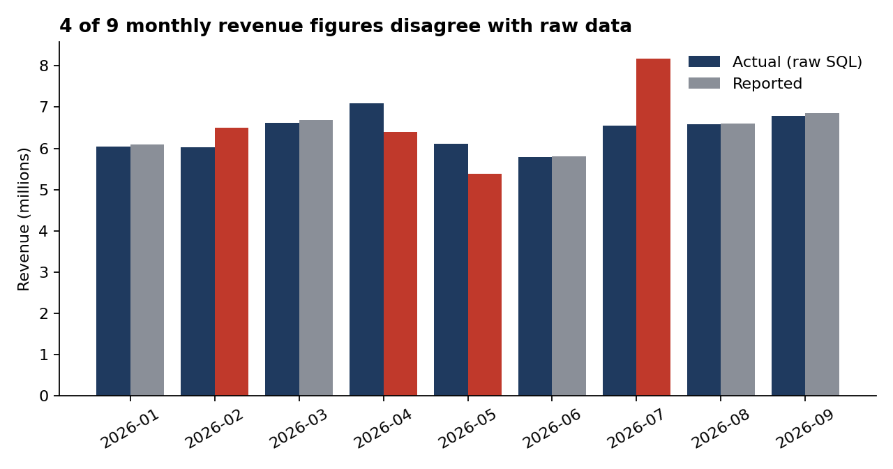
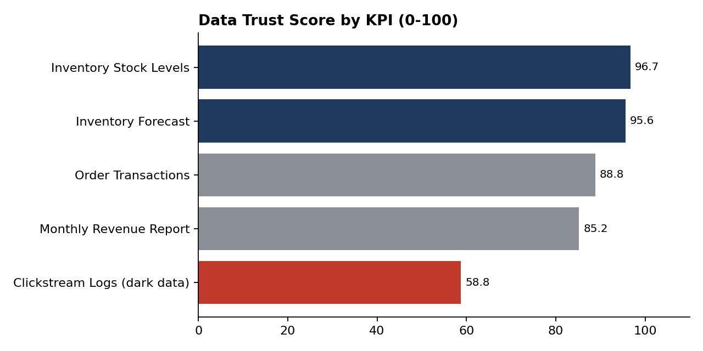

# Dark Data & Data Hallucination Audit

An automated data quality audit that finds unused ("dark") data, checks reports against raw records, and gives every KPI a Data Trust Score.

> **Personal project** built independently to practise data analytics. It was not created for any employer or client.
>
> **Note:** All data in this repo is simulated. The data issues were planted on purpose so the audit could be tested. No real company data is used.

## Project Summary

Teams often have two quiet data problems: valuable files nobody has indexed (**dark data**), and reports that look right but don't match the source (**data hallucination**). This project builds an audit pipeline for a simulated retail business and measures how well it catches both.

**Results at a glance**

| Metric | Result |
|---|---|
| Orders / order items reconciled | 3,000 / 7,466 |
| Unindexed dark files cataloged | 48 (8,443 rows profiled) |
| Planted data issues | 38 |
| Issues detected | **38 of 38 (0 false positives)** |
| KPIs scored for trust | 5 (1 rated Low, 2 Medium, 2 High) |

## Case Study: Retail (fictional scenario)

Imagine a company that runs an e-commerce platform and physical stores.

- **Dark data problem:** clickstream logs, abandoned-cart JSON files, and support chat dumps sit in an unindexed folder, ignored by the sales team.
- **Hallucination problem:** the revenue report and inventory forecast drift from the raw data because of missing values, interpolated months, and bad inputs.

## Approach

### Phase 1: Dark Data Discovery
- Python crawler catalogs files and profiles rows, schemas, and missing values.
- Output: `data/dark_data_catalog.csv`

### Phase 2: Validation and Reconciliation
- SQL and Python checks reconcile reports against raw transaction tables.
- Rules catch future timestamps, negative inventory, schema drift, high null rates, and overforecast products.
- Detection is scored against `data/answer_key.json`.
- Output: `data/audit_log.txt`

### Phase 3: Data Trust Score and Dashboard
Each KPI is scored 0-100 as the average of:
- **Completeness:** share of records present and usable
- **Consistency:** share of records that agree with the source of truth or the rules
- **Freshness:** how recently the data was updated (30-day window)

Output: `data/data_trust_scores.csv`, built for Power BI.

## Findings





**Audit detection (38 planted issues)**

| Issue type | Detected |
|---|---|
| Future-dated orders | 12 / 12 |
| Negative inventory | 6 / 6 |
| Revenue report mismatches | 3 / 3 |
| Interpolated revenue month | 1 / 1 |
| Overforecast products (3x) | 8 / 8 |
| Schema drift files | 5 / 5 |
| High null-rate files | 3 / 3 |

Revenue months off by more than 3% from raw SQL: 2026-02 (+8.0%), 2026-04 (-9.7%), 2026-05 (-12.0%), 2026-07 (+25.0%).

**Data Trust Scores**

| KPI | Score | Level |
|---|---|---|
| Inventory Stock Levels | 96.7 | High |
| Inventory Forecast | 95.6 | High |
| Order Transactions | 88.8 | Medium |
| Monthly Revenue Report | 85.2 | Medium |
| Clickstream Logs (dark data) | 58.8 | Low |

The revenue report loses points on consistency because 4 of 9 months disagree with the raw data. The clickstream dark data scores lowest because it is stale and has many missing user IDs.

**Limitation:** the detectors were written knowing the planted patterns, so 100% detection shows the pipeline works on a controlled test, not on messy real-world data.

## Tech Stack

Python, pandas, NumPy, Matplotlib, SQL (SQLite). Power BI dashboard planned.

## Project Structure

```
.
├── data/
│   ├── retail.db               # Simulated database (ground truth + report tables)
│   ├── dark_data/              # Unindexed clickstream, cart, and chat files
│   ├── answer_key.json         # List of planted issues
│   ├── dark_data_catalog.csv   # Phase 1 output
│   ├── audit_log.txt           # Phase 2 output
│   └── data_trust_scores.csv   # Phase 3 output
├── scripts/
│   ├── generate_data.py        # Builds the simulated data
│   ├── run_audit.py            # Phases 1 and 2
│   ├── trust_score.py          # Phase 3 scoring
│   └── audit_pandas.py         # pandas reconciliation + Matplotlib charts
├── sql/
├── dashboard/                  # Charts (revenue_reconciliation.png, trust_scores.png)
└── README.md
```

## How to Run

```bash
git clone https://github.com/Noorul29/dark-data-hallucination-audit.git
cd dark-data-hallucination-audit
python scripts/generate_data.py
python scripts/run_audit.py
python scripts/trust_score.py
pip install pandas numpy matplotlib
python scripts/audit_pandas.py
```

The first three scripts need only the Python standard library. The chart script needs pandas, NumPy, and Matplotlib.

## Status

- Phase 1 (discovery): complete
- Phase 2 (validation): complete
- Phase 3 (trust scores): complete
- Charts with pandas and Matplotlib: complete
- Power BI dashboard and automated alerts: planned

## Author

**Noorul Hida** · GitHub: [Noorul29](https://github.com/Noorul29)
